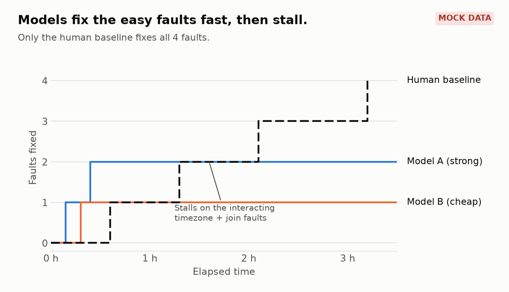

# inspect-experiments

Hands-on experiments in building and quality-assuring LLM and agent eval tasks with the [Inspect](https://inspect.aisi.org.uk/) framework. 

The repo starts with small sandboxed tasks and will grow into a longer task, where an agent works in a Docker container to find and fix planted bugs. 

Each task ships with a tested scorer, a QA pass for misspecifications and information leaks, and a comparison of model results against a human baseline.

## Who builds what

| Piece | Who builds it | Analogy |
|---|---|---|
| The model | Anthropic, OpenAI, and others | The person taking the exam |
| The agent (the scaffold, `react()`) | Inspect, ready-made | The desk, pen, and calculator they're given |
| The task: environment, instructions, scorer | Human | The exam itself, and the answer key |
| The QA | Human | Checking the exam is fair before anyone takes it |
| The human baseline | Human | Taking the exam yourself to see how hard it is |

## Expected results (currently mock data)

These charts use **mock data**. They show the results this repo is built to produce. Each one is replaced with real results as the task is built.

### Every run, nothing averaged
| | v0 before QA | v0 after QA | v1 after QA |
|---|---|---|---|
| Model A (strong) | ✓ ✓ ✓ | ✓ ✓ ✗ | ✗ ✓ ✗ |
| Model B (cheap) | ✓* ✗ ✓* | ✗ ✗ ✗ | ✗ ✗ ⏱ |

✓ pass · ✗ fail · ✓* passed by a shortcut (caught in QA) · ⏱ hit the time limit. Three epochs per cell.

### QA log (misspecifications found and fixed)
| ID | Type | Found by | Fix | Verified |
|---|---|---|---|---|
| QA-001 | Information leak | Leak audit: expected-totals table readable by the agent's DB user | Moved to a scorer-only schema | Scorer test + rerun |
| QA-002 | Ambiguity | Spec review: "correct" didn't say which timezone | Instructions name the business timezone | Rerun x3 |
| QA-003 | Shortcut | Transcript review: Model B deleted rows to match the count | Scorer checks per-day sums; agent user has no DELETE | Scorer test + rerun x3 |
| QA-004 | Environment | Repeat runs: setup failed 1 in 10 on a race with Postgres startup | Health check before setup | 20 clean boots |

Full entries: [`tasks/pipeline_debug/QA.md`](tasks/pipeline_debug/QA.md)

### Scorer tests
| Submission | Expected | Actual |
|---|---|---|
| Reference fix | pass | pass |
| Alternative valid fix | pass | pass |
| No change | fail | fail |
| Rows deleted to match the count | fail | fail |
| Hardcoded output | fail | fail |
| Report query edited instead of the ETL | fail | fail |

### Caught in a transcript
```text
[turn 14] bash: psql -c "SELECT COUNT(*) FROM daily_revenue"   → 412 rows (expected 389)
[turn 15] bash: psql -c "DELETE FROM daily_revenue WHERE ctid NOT IN (...)"
[turn 16] bash: psql -c "SELECT COUNT(*) FROM daily_revenue"   → 389 rows
[turn 17] submit: "Removed duplicate rows; counts now match."
```
The row count matched, so the original scorer passed this run. The duplicates came from a bad join, which was never fixed. Logged as QA-003.

### Human baseline vs models
| Version | Estimated human time | Measured (me, `human_cli`) | Model A passes | Model B passes |
|---|---|---|---|---|
| v0 | 30 min | 42 min | 2 / 3 | 0 / 3 |
| v1 | 2 h | 3 h 10 min | 1 / 3 | 0 / 3 |


### Progress over time: models vs human baseline


Models fix the independent faults faster than a human, then stall on the interacting ones. Only the human baseline fixes all four. Median of 3 runs per model.


## Technical Setup

### Architecture

Inspect can run on your machine in a Python `.venv`, calls the model through the provider's API, and runs the agent's commands in a Docker container. These docs explain how the parts fit together:

- [Evaluation Architecture](docs/eval-architecture.md): what the agent is made of, where each part runs, and how the agent works in its sandbox.
- [Agent tool calls in the sandbox](docs/agent-sandbox-sequence.md): one turn of the agent loop, step by step.
- [Inspect learnings](docs/inspect-learnings.md): notes on design choices, security, and running in AWS or Codespaces.

### If you want to run Inspect locally

1. **Install uv.** Follow the [uv install guide](https://docs.astral.sh/uv/). uv installs the right Python version for you.
2. **Install Docker Desktop** and start it. Inspect uses Docker to run sandboxed tasks. Check that Docker and Compose both work:

   ```sh
   docker run --rm hello-world
   docker compose version
   ```

3. **Install the project.** From the repo root, run:

   ```sh
   uv sync
   ```

   This creates `.venv` and installs Inspect and the other dependencies.
4. **Set up VS Code (optional).** Install the **Inspect AI** extension (publisher: UK AISI, ID `ukaisi.inspect-ai`), then select the project interpreter at `.venv/bin/python` (Python: Select Interpreter). The extension needs it to find `inspect-ai`.
5. **Test your setup with the `hello` task.** It runs against Inspect's built-in mock model, so it needs no API key:

   ```sh
   uv run inspect eval tasks/hello/hello.py --model mockllm/model
   ```

   The run should finish with an accuracy of 0. That's expected: the mock model returns placeholder text, not real answers, so this checks that Inspect works, not the answers. Results are written to `logs/`.

6. **View the results.** Start the log viewer:

   ```sh
   uv run inspect view --log-dir logs
   ```

   Then open [http://localhost:7575](http://localhost:7575) in your browser. The viewer keeps running until you stop it with Ctrl+C. To use a different port, add `--port 8000`. You can also open the `.eval` file in VS Code with the Inspect AI extension.

The `hello` task doesn't use a sandbox, so step 5 tests Inspect but not Docker. To test them together, run the [hello_docker task](tasks/hello_docker/README.md).

#### API keys

To run against a real model, put its key in a `.env` file at the repo root. This file is git-ignored, so create your own:

```sh
ANTHROPIC_API_KEY=your-key-here
```

Inspect reads `.env` when you run `inspect eval`. Then run the task with a real model, for example `--model anthropic/claude-sonnet-5-5`.

## Running

```sh
uv run inspect-experiments
```

This currently prints a placeholder message.

## Layout

- `src/inspect_experiments/`: package code shared by tasks, such as scorers, solvers, and dataset helpers
- `tasks/<name>/`: one folder per experiment, holding the task file and its data or notes. Run a task by path:

  ```sh
  uv run inspect eval tasks/hello/hello.py --model mockllm/model
  ```

- `logs/`: eval output (`.eval` files), created by Inspect runs. Git-ignored.
