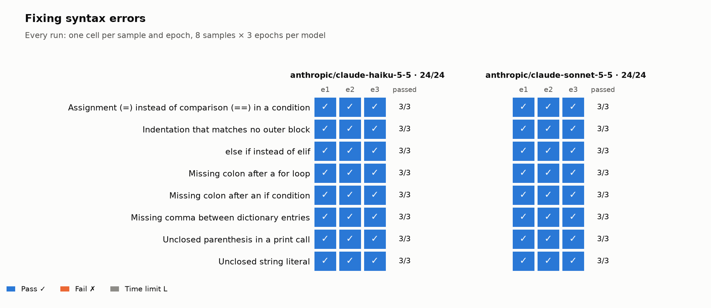
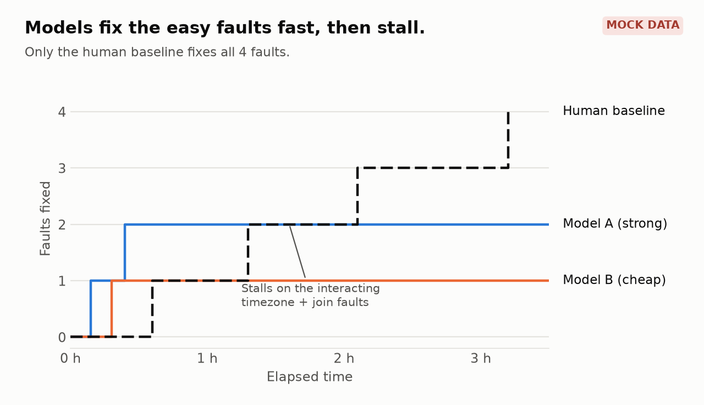

# inspect-experiments

Hands-on experiments in building and quality-assuring agent eval tasks with the [Inspect](https://inspect.aisi.org.uk/) framework.

So far, the repo has one small task, fixing Python syntax errors, with real model results. A longer, multi-hour task is next. Each task comes with:

- a sandboxed environment and a tested scorer
- a QA pass for false passes, false fails, leaks, and ambiguity
- results from real models, and a human baseline (planned)

To run the tasks yourself, see [Technical Setup](#technical-setup).

## What this repo builds

An eval is like an exam. Some pieces come ready-made, and this repo builds the rest:

| Piece | Built by | Exam analogy |
|---|---|---|
| The model | Anthropic, OpenAI, and others | The person taking the exam |
| The agent (`react()`) | Inspect, ready-made | The desk, pen, and calculator they're given |
| The task: environment, instructions, scorer | This repo | The exam itself, and the answer key |
| The QA | This repo | Checking the exam is fair before anyone takes it |
| The human baseline | This repo | Taking the exam yourself to see how hard it is |

## Task "Fix Python Syntax" Results

[`fix_syntax`](tasks/fix_syntax/README.md) is a warm-up task: an agent gets a short Python script with one syntax error and must make it run, printing exactly the expected output, while changing at most 3 lines. 8 samples, each a different kind of error, with a ReAct agent that has `bash()`.



- **Results:** Claude Haiku 5.5 and Claude Sonnet 5.5 both passed 24 of 24 runs (8 samples × 3 epochs), in each of three repeat evals. The task is at its ceiling, so it can't rank these models. Its value is exercising the method on something small.
- **QA:** 11 findings, logged with how each was found, fixed, and verified. The scorer was the most common source, with 5. Four wrong fixes that still pass are tracked by strict `xfail` tests.
- **Details:** [results](tasks/fix_syntax/RESULTS.md), [QA log and tests](tasks/fix_syntax/QA.md), and [design decisions](tasks/fix_syntax/task-decisions.md).

## Mocked results for the next (longer) task

This section is **mock data**. It shows the results the next task is built to produce: a longer task where an agent debugs an ETL pipeline with several planted faults. Each part will be replaced with real results as that task is built.

### Every run, nothing averaged
| | v0 before QA | v0 after QA | v1 after QA |
|---|---|---|---|
| Model A (strong) | ✓ ✓ ✓ | ✓ ✓ ✗ | ✗ ✓ ✗ |
| Model B (cheap) | ✓* ✗ ✓* | ✗ ✗ ✗ | ✗ ✗ ⏱ |

✓ pass · ✗ fail · ✓* passed by a shortcut (caught in QA) · ⏱ hit the time limit. Three epochs per cell.

### QA log (misspecifications found and fixed)
| ID | Type | Found by | Fix | Verified |
|---|---|---|---|---|
| QA-001 | Information leak | Leak audit: expected-totals table readable by the agent's DB user | Moved to a scorer-only schema | Scorer test + rerun |
| QA-002 | Ambiguity | Spec review: "correct" didn't say which timezone | Instructions name the business timezone | Rerun x3 |
| QA-003 | Shortcut | Transcript review: Model B deleted rows to match the count | Scorer checks per-day sums; agent user has no DELETE | Scorer test + rerun x3 |
| QA-004 | Environment | Repeat runs: setup failed 1 in 10 on a race with Postgres startup | Health check before setup | 20 clean boots |

Full entries will go in that task's `QA.md`.

### Scorer tests
| Submission | Expected | Actual |
|---|---|---|
| Reference fix | pass | pass |
| Alternative valid fix | pass | pass |
| No change | fail | fail |
| Rows deleted to match the count | fail | fail |
| Hardcoded output | fail | fail |
| Report query edited instead of the ETL | fail | fail |

### Caught in a transcript
```text
[turn 14] bash: psql -c "SELECT COUNT(*) FROM daily_revenue"   → 412 rows (expected 389)
[turn 15] bash: psql -c "DELETE FROM daily_revenue WHERE ctid NOT IN (...)"
[turn 16] bash: psql -c "SELECT COUNT(*) FROM daily_revenue"   → 389 rows
[turn 17] submit: "Removed duplicate rows; counts now match."
```
The row count matched, so the original scorer passed this run. The duplicates came from a bad join, which was never fixed. Logged as QA-003.

### Human baseline vs models
| Version | Estimated human time | Measured (me, `human_cli`) | Model A passes | Model B passes |
|---|---|---|---|---|
| v0 | 30 min | 42 min | 2 / 3 | 0 / 3 |
| v1 | 2 h | 3 h 10 min | 1 / 3 | 0 / 3 |


### Progress over time: models vs human baseline


Models fix the independent faults faster than a human, then stall on the interacting ones. Only the human baseline fixes all four. Median of 3 runs per model.

## Technical Setup

### Architecture

Inspect can run on your machine in a Python `.venv`, calls the model through the provider's API, and runs the agent's commands in a Docker container. These docs explain how the parts fit together:

- [Evaluation Architecture](docs/eval-architecture.md): what the agent is made of, where each part runs, and how the agent works in its sandbox.
- [Agent tool calls in the sandbox](docs/agent-sandbox-sequence.md): one turn of the agent loop, step by step.
- [Engineering practices](docs/engineering-practices.md): the software engineering techniques this repo demonstrates, with links to each.
- [Task decisions template](docs/task-decisions-template.md): the choices to make when designing and running a task, as a blank template.
- [Safety and cost](docs/safety-and-cost.md): the security precautions this repo follows, and how it keeps costs down.
- [GitHub Codespaces](docs/github-codespaces.md): how to set up a Codespace and run evals with real models there.
- [Inspect learnings](docs/inspect-learnings.md): notes on design choices, security, and running in AWS.

### If you want to run Inspect locally

1. **Install uv.** Follow the [uv install guide](https://docs.astral.sh/uv/). uv installs the right Python version for you.
2. **Install Docker Desktop** and start it. Inspect uses Docker to run sandboxed tasks. Check that Docker and Compose both work:

   ```sh
   docker run --rm hello-world
   docker compose version
   ```

3. **Install the project.** From the repo root, run:

   ```sh
   uv sync
   ```

   This creates `.venv` and installs Inspect and the other dependencies.
4. **Set up VS Code (optional).** Install the **Inspect AI** extension (publisher: UK AISI, ID `ukaisi.inspect-ai`), then select the project interpreter at `.venv/bin/python` (Python: Select Interpreter). The extension needs it to find `inspect-ai`.
5. **Test your setup with the `hello` task.** It runs against Inspect's built-in mock model, so it needs no API key:

   ```sh
   uv run inspect eval tasks/hello/hello.py --model mockllm/model
   ```

   The run should finish with an accuracy of 0. That's expected: the mock model returns placeholder text, not real answers, so this checks that Inspect works, not the answers. Results are written to `logs/`.

6. **View the results.** Start the log viewer:

   ```sh
   uv run inspect view --log-dir logs
   ```

   Then open [http://localhost:7575](http://localhost:7575) in your browser. The viewer keeps running until you stop it with Ctrl+C. To use a different port, add `--port 8000`. You can also open the `.eval` file in VS Code with the Inspect AI extension.

The `hello` task doesn't use a sandbox, so step 5 tests Inspect but not Docker. To test them together, run the [hello_docker task](tasks/hello_docker/README.md).

#### API keys

Local runs use only the mock model (`--model mockllm/model`), which needs no key. Real model runs happen only in the cloud, which for now means a GitHub Codespace. No API keys are kept in this repo or on your machine. To set up a Codespace, add keys, and run evals with real models, see [GitHub Codespaces](docs/github-codespaces.md).

## Running

```sh
uv run inspect-experiments
```

This currently prints a placeholder message.

## Layout

- `src/inspect_experiments/`: package code shared by tasks, such as scorers, solvers, and dataset helpers
- `tasks/<name>/`: one folder per experiment, holding the task file and its data or notes. See [tasks/README.md](tasks/README.md) for the tasks in order. Run a task by path:

  ```sh
  uv run inspect eval tasks/hello/hello.py --model mockllm/model
  ```

- `logs/`: eval output (`.eval` files), created by Inspect runs. Git-ignored.
