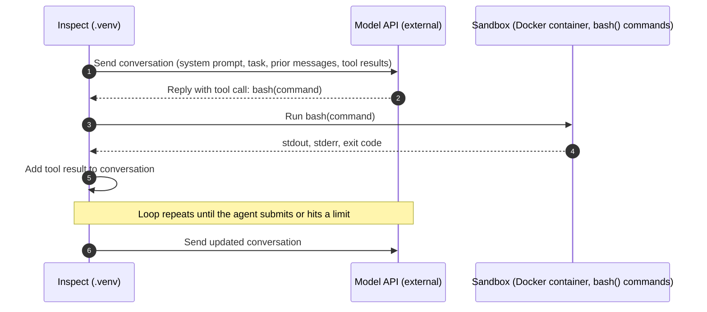
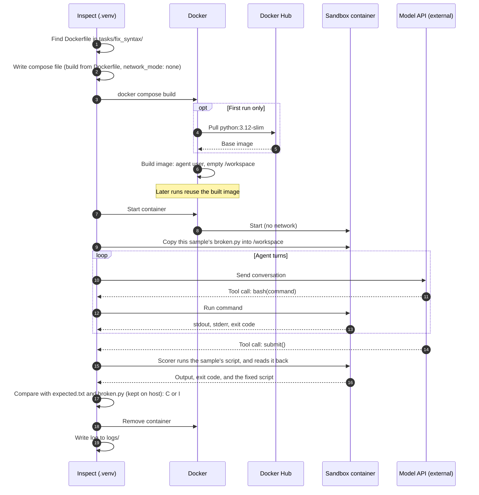

# Agent tool calls in the sandbox

This diagram shows one turn of the agent loop. Inspect runs the loop in `.venv`. The model is called through the provider's API, and tool commands run in the Docker container.

Notes:

- The container only runs commands. It never calls the model API.
- Every tool result goes back into the conversation, so the model sees the output of each command in the next turn.

## Where the conversation comes from

The model API doesn't remember anything between calls. Inspect keeps the conversation for each sample as a `messages` list in its `TaskState` and sends the whole list on every call.

- **Start:** a system message from the solver or agent setup, and a user message with the sample's `input` from the dataset.
- **Each turn:** the model's reply is added as an assistant message, and each tool result from the sandbox is added as a tool message. Tool descriptions, such as `bash()`, go with every call so the model knows what it can call.
- **Cost:** each call resends the full history, so calls get larger as a long run goes on. Prompt caching and a `token_limit` help.
- **Long output:** a large command output, such as a `cat` of a big CSV file, stays in the history and is resent every turn. Keep tool output short.
- **Logs:** `inspect view` shows each sample's message list, so you can see what the model saw at every turn.

## A full run: fix_syntax

The diagram above shows one turn. This one shows a whole run of one `fix_syntax` sample, from building the sandbox to scoring and cleanup. Each sample gets its own container, so this repeats for every sample. The agent turns in the middle are the loop above.

- **Steps 1–2:** Inspect finds the `Dockerfile` in the task's folder, so it builds an image instead of using its default one. See [How Inspect picks the sandbox image](eval-architecture.md#how-inspect-picks-the-sandbox-image).
- **Steps 3–6:** Docker pulls the base image only on the first run, then builds the task's image. The image contains no scripts.
- **Step 9:** Inspect copies only this sample's `broken.py` into the container. The reference fix (`fixed.py`) and the answer key (`expected.txt`) never reach it.
- **The agent loop:** the model calls `bash()` until it submits. The container has no network, so it can only run commands.
- **Scoring:** the scorer runs the script in the same container and reads it back. It checks the output against `expected.txt`, and checks that at most 3 lines differ from `broken.py`. Both files are kept on the host, so the agent can't change them.
- **Cleanup:** Inspect removes the container. The image stays, so the next run starts faster.
