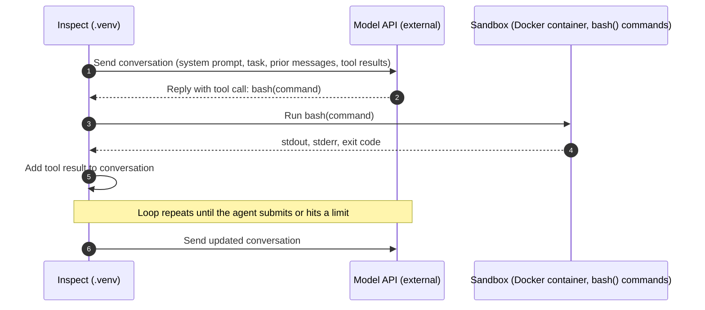

# Agent tool calls in the sandbox

This diagram shows one turn of the agent loop. Inspect runs the loop in `.venv`. The model is called through the provider's API, and tool commands run in the Docker container.

Notes:

- The container only runs commands. It never calls the model API.
- Every tool result goes back into the conversation, so the model sees the output of each command in the next turn.

## Where the conversation comes from

The model API doesn't remember anything between calls. Inspect keeps the conversation for each sample as a `messages` list in its `TaskState` and sends the whole list on every call.

- **Start:** a system message from the solver or agent setup, and a user message with the sample's `input` from the dataset.
- **Each turn:** the model's reply is added as an assistant message, and each tool result from the sandbox is added as a tool message. Tool descriptions, such as `bash()`, go with every call so the model knows what it can call.
- **Cost:** each call resends the full history, so calls get larger as a long run goes on. Prompt caching and a `token_limit` help.
- **Long output:** a large command output, such as a `cat` of a big CSV file, stays in the history and is resent every turn. Keep tool output short.
- **Logs:** `inspect view` shows each sample's message list, so you can see what the model saw at every turn.
