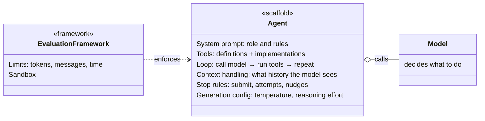
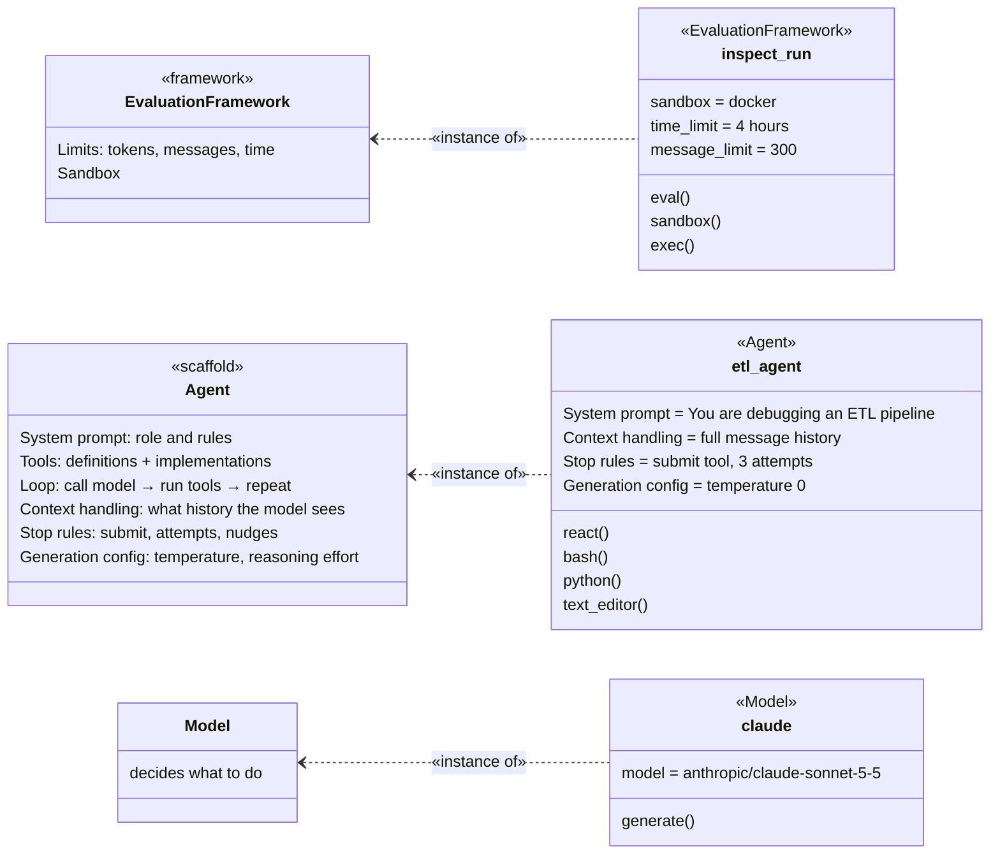
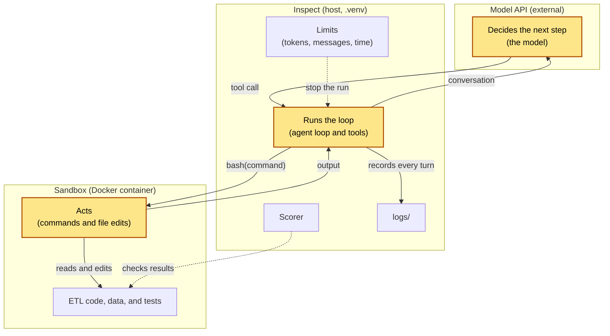
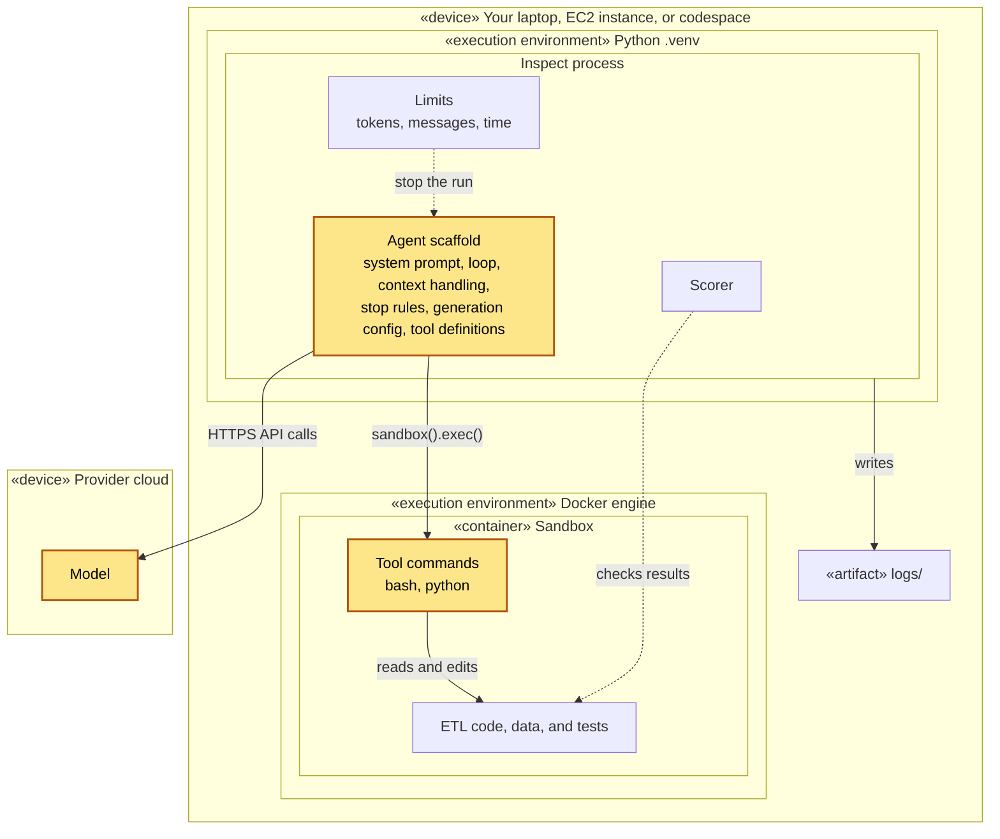

# Evaluation Architecture

How the parts of an eval fit together: what the agent is made of, where each part runs, and how the agent works in its sandbox. For the turn-by-turn flow, see [agent-sandbox-sequence.md](agent-sandbox-sequence.md).

## Evaluation System Components

The whole evaluation system: the framework, the agent inside a task, and the model it calls. Solid boxes are owned parts. The dashed Model is shared and runs at the provider.

```
┌───────────── «evaluation framework» Inspect ─────────────┐
│ eval()        runs samples, epochs, concurrency          │
│ Limits        tokens, messages, time                     │
│ Model client  one interface for every provider           │
│ Logs          every message, tool call, and score        │
│                                                          │
│ ┌──────────────────────── Task ────────────────────────┐ │
│ │ Dataset    samples: input, target, files             │ │
│ │                                                      │ │
│ │ ┌───────── «scaffold» Agent (the solver) ──────────┐ │ │
│ │ │ prompt, tools, loop, context, stop rules, config │ │ │
│ │ └──────────────────────────────────────────────────┘ │ │
│ │                                                      │ │
│ │ Scorer     checks the agent's result                 │ │
│ └──────────────────────────────────────────────────────┘ │
│                                                          │
│ ┌────────────── Sandbox (one per sample) ──────────────┐ │
│ │ ETL code, data, and tests                            │ │
│ └──────────────────────────────────────────────────────┘ │
└──────────────────────────────────────────────────────────┘
          ┆ generate() over HTTPS
   ┌┄┄┄┄┄┄┄┄┄┄┄┄┄┄┄┄┄┐
   ┆      Model      ┆  shared, runs at the provider
   └┄┄┄┄┄┄┄┄┄┄┄┄┄┄┄┄┄┘
```

## Class Diagram
There are three classes:

- **EvaluationFramework** «framework» holds the limits and the sandbox. It **enforces** them on the Agent from outside, shown by the dashed dependency arrow.
- **Agent** «scaffold» holds the system prompt, tools, loop, context handling, stop rules, and generation config. It **calls** a Model.
- **Model** decides what to do. The Agent **aggregates** it (hollow diamond): the Model is part of the agent, but it exists on its own and can be shared.




## Object Diagram

The object diagram shows the classes coming to life in this repo. The classes describe what any evaluation framework, agent, and model are. The objects are what exists when you run `inspect eval`: Inspect reads the task, builds the agent with this repo's prompt and tools, connects to the model you chose, and starts a sandbox. The objects live only for the run. When it ends, they're gone, and the log is what remains.

The same objects come to life wherever the eval runs, whether on your personal machine, an EC2 instance, or a codespace. The environment changes where each object runs, which the Deployment section shows, but not what the objects are.

Classes are on the left and their objects are on the right, so each row reads from class to object. A dashed «instance of» arrow points from each object to its class, and the object's label, such as «Agent», names that class too.



The diagram has three example objects:

- **inspect_run** is the EvaluationFramework for this eval: a Docker sandbox, a 4-hour time limit, and a 300-message limit. It uses `eval()` to run the task, and `sandbox()` and `exec()` to run commands in the container.
- **etl_agent** is the Agent: a system prompt for debugging an ETL pipeline, the full message history, a submit tool with 3 attempts, and temperature 0. It's built from `react()` and the `bash()`, `python()`, and `text_editor()` tools.
- **claude** is the Model: `anthropic/claude-sonnet-5-5`, called with `generate()`.

## Inspect and The Agent


This diagram shows how Inspect runs an eval. It:

1. runs the agent loop
1. defines the agent's tools and dispatches each tool call
1. starts the sandbox, runs commands in it, and removes it after each sample
1. calls the model with the conversation and receives its replies
1. enforces limits on tokens, messages, and time
1. scores the agent's result
1. logs every message, tool call, and score

The highlighted boxes are the agent: it decides at the model API, runs in Inspect's loop, and acts in the sandbox. The other boxes are Inspect's own parts and the files the agent works on.

**What "agent" means in an Inspect eval.** The word doesn't name one component. It's used in three ways:

- **In Inspect's code,** an agent is the scaffold: a Python function, such as `react()`, that runs the loop with a system prompt and tools. It's the task's solver. By default it uses the model you choose with `--model`, so the model isn't written into it.
- **In eval results,** the agent is the model and the scaffold together. Changing either one changes the score, so results name both, such as "Claude Sonnet with a `react()` scaffold."
- **At run time,** the agent is spread across three places: the model decides at the provider, the scaffold runs in Inspect, and its commands act in the sandbox. The highlighted boxes show this.

This doc uses the second meaning: the Agent is the scaffold plus the model it calls, as in the class diagram.




- **Decides (model API).** The model reads the conversation and picks the next tool call. This is the agent's "thinking."
- **Runs the loop (Inspect).** Inspect sends the conversation, dispatches tool calls, and adds the results back. This is the agent's "body."
- **Acts (sandbox).** The commands and file edits happen in the container. This is where the agent's work lands.
- **Not the agent:** the limits stop the agent's run, the scorer judges its work, `logs/` records it, and the ETL files are what the agent works on.

## Deployment

In plain terms, the eval runs in three places:

- **Inspect (host, `.venv`).** Runs the task, the agent loop, the tools, and the scorer. Holds the API key and makes every model call.
- **Model API (external).** Receives the conversation and replies with text or tool calls. It never touches the container.
- **Sandbox (Docker container).** Runs the commands the agent's tools send. It has no API key and, by default, no network access.

The diagram below shows the same thing as a deployment diagram, using UML deployment notation. It maps the parts of the Agent class, and the framework around it, to the machines and runtimes they run on. `«device»` is a machine, `«execution environment»` is a runtime on that machine, and `«container»` is a Docker container. As in the diagram above, the highlighted boxes are the agent.



The class diagram and the deployment don't line up exactly:

- **Most of the scaffold runs in one place.** The system prompt, loop, context handling, stop rules, generation config, and tool definitions all run in the Inspect process.
- **Tools are split.** Their definitions run in Inspect, but their commands run in the sandbox.
- **The model is part of the agent but runs elsewhere.** The Agent class aggregates it, but it runs in the provider's cloud and is reached over HTTPS.
- **Limits and the sandbox are outside the agent.** Inspect enforces them on the agent, not as part of it.

## Container lifecycle

1. **Build.** On the first run, Inspect builds the image with `docker compose` from the task's Dockerfile, or pulls its default image if the task has no Docker files. See [How Inspect picks the sandbox image](#how-inspect-picks-the-sandbox-image). Later runs reuse the image until the Dockerfile changes.
2. **Start.** Inspect starts a fresh container for each sample, so one sample's changes never carry over to the next.
3. **Run.** The agent's tool calls run in the container until the agent submits or hits a limit.
4. **Score.** The scorer runs on the host. It can still run commands in the container, such as the test suite, before cleanup.
5. **Clean up.** Inspect removes the container. To keep it for debugging, run with `--no-sandbox-cleanup`.

## How tool calls reach the container

- The model replies with a tool call, such as `bash(command)`. Inspect parses it and runs the tool on the host.
- The tool calls `sandbox().exec()`, which runs the command in the container and returns stdout, stderr, and the exit code.
- The result goes back into the conversation as a tool message, and the model sees it on its next turn.
- Large outputs are truncated before they go back to the model. Tools also accept a timeout, so a hung command doesn't stall the run.

## How files get into the container

- **At build time:** the Dockerfile's `COPY` lines bake in the ETL code, data, and tests. This is the default for this task.
- **Per sample:** a sample's `files` field copies files in when the container starts, for variations that differ by sample.
- **At run time:** solvers and scorers can call `sandbox().write_file()` and `sandbox().read_file()`.

## What the agent's commands can and can't do

- **Can:** read and edit any file in the container, run Python and shell commands, and run the tests.
- **Can't:** call the model API, read files on the host, or reach the network. When Inspect writes the compose file for you, from its default image or the task's Dockerfile, it sets `network_mode: none`. A task that supplies its own compose file controls networking itself, so check that file's setting.
- **Risk:** the agent can also edit the tests or the expected output. The scorer should check results against a copy the agent can't change, such as one kept on the host.

## How Inspect picks the sandbox image

A task asks for a Docker sandbox with `sandbox="docker"`. Inspect then looks in the task's folder and uses the first of these it finds:

1. **A compose file,** such as `compose.yaml`. Inspect uses it as is, with whatever image, networking, and limits it sets. You must set `network_mode: none` yourself.
2. **A `Dockerfile`.** Inspect builds the image from it and writes a compose file around it, with `network_mode: none`.
3. **Neither.** Inspect writes a generic compose file that uses its default image, `aisiuk/inspect-tool-support` (Linux with Python 3.12), also with `network_mode: none`.

To point to a compose file somewhere else, pass its path: `sandbox=("docker", "path/to/compose.yaml")`.

In this repo, `hello_docker` has no Docker files, so it uses the default image. The ETL task will use its own Dockerfile (option 2). The logic is in Inspect's `resolve_compose_file()` in `inspect_ai/util/_sandbox/docker/config.py`.

## Dockerfile

The ETL task's Dockerfile isn't written yet. It's planned to install:

- **Base image:** a pinned slim Python image, such as `python:3.12-slim`.
- **System tools:** `bash`, `git` (so the agent can see its own changes with `git diff`), `diffutils`, and `procps`. `grep`, `sed`, and the other core utilities come with the base image.
- **Python packages:** `pandas` for the pipeline and `pytest` for its tests, with pinned versions.
- **Inspect tool support:** the `inspect-tool-support` package, if the task uses `text_editor()` or `bash_session()`. Check the Inspect tools docs for whether it's still required.
- **Task files:** the ETL code, its input data, and its tests, copied to `/workspace`.
- **User:** a non-root `agent` user that owns `/workspace`.

Left out on purpose:

- **No API keys or `.env` file.** The agent doesn't need them.
- **No network tools,** such as `curl`. The container has no network anyway: Inspect's generated compose file sets `network_mode: none`. If the task later adds its own compose file, keep that setting.
- **No expected outputs.** These stay on the host so the agent can't read or change them.
