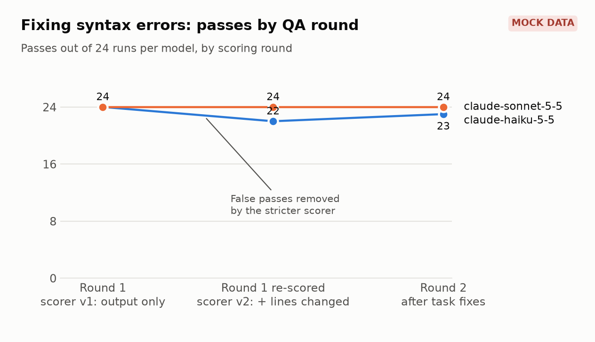

# fix_syntax: QA

How this task was checked, what the checks found, and how each problem was fixed. For the task design and model results, see [RESULTS.md](RESULTS.md).

**What's real and what's mock on this page:**

| Section | Status |
|---|---|
| QA log, tests, failure review, transcript | Real |
| QA rounds chart | **Mock.** Shows the planned format. No run has been re-scored across QA rounds yet |

## What QA means here

QA checks that a score reflects the model, not a flaw in the task. That covers more than the scorer. A task can be wrong in four ways:

- **False passes:** the scorer can be fooled, so a model passes without really doing the task.
- **Leaks:** the answer can reach the model.
- **False fails:** the environment or harness breaks, so a model fails for the task's fault, not its own.
- **Ambiguity:** reasonable readings of the instructions get different scores.

A setup bug like QA-001 counts because it would have caused false fails: agents would have failed for reasons unrelated to their ability.

## QA log

Findings are grouped by the stage they came up in. IDs are in the order they were logged.

<!-- HTML tables, so each row can be top-aligned. Markdown tables can't set vertical alignment. -->

### Building

Found while creating the sandbox and samples, before any model ran.

<table>
<thead>
<tr valign="top"><th>ID</th><th>Type</th><th>Severity</th><th>Found by</th><th>Fix</th><th>Verified by</th></tr>
</thead>
<tbody>
<tr valign="top">
<td>QA-001</td><td>Environment (false fail)</td><td>High</td>
<td>Listing <code>/workspace</code> in the built sandbox: it was owned by root, so the agent couldn't create files there, and <code>sed -i</code> fixes would fail</td>
<td>The Dockerfile gives the <code>agent</code> user ownership of <code>/workspace</code></td>
<td><code>test_agent_user_can_edit_every_script</code></td>
</tr>
<tr valign="top">
<td>QA-003</td><td>Information leak</td><td>High</td>
<td>Reviewing the build context: the reference fix sat next to the Dockerfile, so a <code>COPY .</code> line would put it in the image</td>
<td>Only each sample's broken script is copied in, at run time. <code>.dockerignore</code> hides the whole task folder from the build</td>
<td>A test build with <code>COPY .</code> found nothing to copy</td>
</tr>
</tbody>
</table>

### Spec and scorer review

Found by reading the instructions, scorer, and terms, looking for ways to pass or fail wrongly.

<table>
<thead>
<tr valign="top"><th>ID</th><th>Type</th><th>Severity</th><th>Found by</th><th>Fix</th><th>Verified by</th></tr>
</thead>
<tbody>
<tr valign="top">
<td>QA-002</td><td>Shortcut (false pass)</td><td>High</td>
<td>The first scorer checked only the output, so replacing the script with a <code>print()</code> of the answer would pass</td>
<td>Scorer v2 also fails runs that change more than 3 lines</td>
<td><code>test_hardcoded_output_fails</code>, marked <code>xfail</code> while the shortcut was open</td>
</tr>
<tr valign="top">
<td>QA-004</td><td>Shortcut (false pass, open)</td><td>Medium</td>
<td>A one-line logic change, such as <code>if True:</code>, prints the right output for this data</td>
<td>Not fixed yet. Planned: run each fixed script on a second, hidden input at scoring time</td>
<td><code>test_if_true_fails</code>, marked <code>xfail</code> until fixed</td>
</tr>
<tr valign="top">
<td>QA-007</td><td>Data (leak)</td><td>Medium</td>
<td>Reviewing the terms: a free-tier model API may train on prompts, which could leak the task into training data</td>
<td>Paid API keys only for real runs</td>
<td>Recorded in <a href="../../docs/safety-and-cost.md">safety-and-cost.md</a></td>
</tr>
<tr valign="top">
<td>QA-008</td><td>Data (leak, open)</td><td>Medium</td>
<td>The canary string is only in <code>RESULTS.md</code> and <code>QA.md</code>. Training-data filters check one document at a time, so the sample files, which hold the answers, could be collected without it</td>
<td>Won't fix. Since a canary protects held-out value and this task has none (common syntax errors).</td>
</tr>
<tr valign="top">
<td>QA-009</td><td>Shortcut (false pass, open)</td><td>Medium</td>
<td>Red-teaming the scorer: replacing a calculation with its result, <code>avg = 84.7</code>, plus the colon fix, prints the right output for <code>missing_colon_if</code>. The script no longer calculates anything</td>
<td>Not fixed yet. The hidden input planned for QA-004 catches it, since a hardcoded value is wrong for other data</td>
<td><code>test_hardcoded_average_fails</code>, marked <code>xfail</code> until fixed</td>
</tr>
<tr valign="top">
<td>QA-010</td><td>Shortcut (false pass, open)</td><td>Low</td>
<td>Red-teaming the scorer: fixing <code>=</code> as <code>&gt;=</code> instead of <code>==</code> in <code>assign_in_condition</code> prints the right output, because exactly the expected number of people are present. It would say "Everyone is here" with more people than expected</td>
<td>Not fixed yet. The hidden input catches it, if its data has more people present than expected</td>
<td><code>test_looser_comparison_fails</code>, marked <code>xfail</code> until fixed</td>
</tr>
<tr valign="top">
<td>QA-011</td><td>Shortcut (false pass, open)</td><td>Medium</td>
<td>Red-teaming the scorer: deleting the broken line, <code>"tea": 2.75</code>, in <code>missing_comma</code> prints the right output, because nobody ordered tea. It removes a menu item instead of fixing the comma</td>
<td>Not fixed yet. A hidden input only catches it if its order includes tea. A more direct check: fail any run that deletes a line from the original script</td>
<td><code>test_deleted_broken_line_fails</code>, marked <code>xfail</code> until fixed</td>
</tr>
</tbody>
</table>

QA-009 to QA-011 came from red-teaming the scorer: writing wrong fixes on purpose and checking whether the scorer passes them. They share a pattern with QA-004: the output matches this sample's data, but the code's behavior changed. A stricter check must still accept valid alternative fixes, such as a separate `if` in place of `elif` in `else_if`, which behaves the same for every input. `test_separate_if_instead_of_elif_passes` guards that.

### Run review

Found by reading the logs and transcripts of real runs.

<table>
<thead>
<tr valign="top"><th>ID</th><th>Type</th><th>Severity</th><th>Found by</th><th>Fix</th><th>Verified by</th></tr>
</thead>
<tbody>
<tr valign="top">
<td>QA-005</td><td>Harness</td><td>Medium</td>
<td>A Gemini run was cut off by the time limit after fixing the file, and scored <code>C</code></td>
<td>No scoring change, by design (see <a href="RESULTS.md#how-a-run-is-scored">How a run is scored</a>). Limit hits are reported per model</td>
<td>The <code>limit_hits</code> count in <code>results/results.json</code></td>
</tr>
<tr valign="top">
<td>QA-006</td><td>Harness (false fail)</td><td>Medium</td>
<td>Runs stalled for minutes on model calls that never returned. Inspect sets no request timeout by default</td>
<td>Runs use <code>--attempt-timeout</code> and <code>--time-limit</code></td>
<td>Documented in the Codespaces guide</td>
</tr>
</tbody>
</table>

### Findings by source

The scorer was the most common source of problems in this task: 5 of the 11 findings.

| Source | Findings | Count |
|---|---|---|
| Scorer | QA-002, QA-004, QA-009, QA-010, QA-011 | 5 |
| Leaks | QA-003, QA-007, QA-008 | 3 |
| Harness | QA-005, QA-006 | 2 |
| Environment | QA-001 | 1 |

## Passes by QA round (mock)



**This chart is mock.** It shows the planned format: score a round of runs, re-score the same runs with the fixed scorer, then fix the task and run again. That separates scorer problems from model behavior. Scorer v2 and the task fixes (QA-001 to QA-003) came before the first full run, so no real run has been re-scored yet.

## Tests

`uv run pytest tasks/fix_syntax/tests` · 23 tests: 19 pass, and 4 are expected failures (`xfail`) that track open gaps

Each scorer test checks the verdict, the scorer's recorded reason for a pass or fail, as well as the score. So a test can't pass for the wrong reason. The verdicts are listed in the task [README](README.md#how-its-scored).

| Case | Applied to | Expected | Actual |
|---|---|---|---|
| Broken script really fails to compile, fix prints `expected.txt`, files differ by one line | all 8 samples (host) | pass | pass |
| Every sample folder is listed in `samples.json`, and vice versa | all 8 samples (host) | pass | pass |
| Reference fix | all 8 samples | `C`, `fixed` | `C`, `fixed` |
| No change, failing with the script's error | all 8 samples | `I`, `still_broken` | `I`, `still_broken` |
| Agent user can edit the script with `sed -i` | all 8 samples | works | works |
| Prints the average to 2 decimals instead of 1 | `missing_colon_if` | `I`, `wrong_output` | `I`, `wrong_output` |
| Right output, then exits with an error | `missing_colon_if` | `I`, `still_broken` | `I`, `still_broken` |
| Reference fix plus a blank line | `missing_colon_if` | `C`, `fixed` | `C`, `fixed` |
| Another valid fix, `if (avg > 80):` | `missing_colon_if` | `C`, `fixed` | `C`, `fixed` |
| Script replaced with a `print()` of the answer | `missing_colon_if` | `I`, `rewritten` | `I`, `rewritten` |
| Script deleted | `missing_colon_if` | `I`, `missing` | `I`, `missing` |
| Valid alternative: separate `if` in place of `elif` | `else_if` | `C`, `fixed` | `C`, `fixed` |

**Open gaps** (`xfail`): each wrong fix should score `I` but scores `C` today. The tests use `strict=True`, so once the scorer catches a gap, its test is reported as an unexpected pass until the marker is removed.

| Case | Applied to | Gap | Expected | Actual |
|---|---|---|---|---|
| `if True:` in place of `if avg > 80:` | `missing_colon_if` | QA-004 | `I` | `C` |
| `avg = 84.7` in place of the calculation | `missing_colon_if` | QA-009 | `I` | `C` |
| `>=` in place of `==` | `assign_in_condition` | QA-010 | `I` | `C` |
| Broken line `"tea": 2.75` deleted | `missing_comma` | QA-011 | `I` | `C` |

## Manual log review checklist

`summarize_results.py` pulls everything countable out of the logs: score, verdict, lines changed, limit hits, errors, time, and tokens. The checks below need a person reading the log, because they're about how a run got its result, not the result itself. Open a log with `inspect view` or the Inspect AI extension. The transcript is in each sample's **Messages** tab, and the run settings are in the eval's **Info** tab.

**Once per eval, in the log header**

- [ ] **The run was configured as intended:** model name, task args (`solution: agent`), commit, epochs, and limits.
- [ ] **The model got the expected system message and tools:** `react()`'s default prompt, and `bash()` plus `submit()`. See [What the agent sees](README.md#what-the-agent-sees).

**On every pass, or a sample of them, until the scorer is stricter**

- [ ] **The fix was the real fix.** A pass with 1 line changed can still be a wrong fix: `if True:`, a hardcoded value, a looser comparison, or a deleted line (QA-004, QA-009 to QA-011). Read the agent's edit command, such as its `sed` or file write, and check that it repaired the syntax without changing the logic. This check stops being needed once the scorer catches these fixes itself.

**On every failure, limit hit, and error**

- [ ] **Model's fault or the task's?** Label it as a model error, unclear instructions, an environment problem (such as a permission or a missing tool), or a harness issue (such as a stalled model call). Only model errors count against the model. Record the label in [Failure review](#failure-review).
- [ ] **Why it hit the limit:** looping, slow model calls, or a correct fix that was never submitted (QA-005).

**On any run, even one that passed**

- [ ] **No tool errors:** `Permission denied`, `command not found`, or a failed `python3`. An environment problem can hide inside a passing run.
- [ ] **No looking for the answer:** searching the filesystem for `expected.txt` or `fixed.py`, reading outside `/workspace`, trying the network, or touching `python3`. These are attempted leaks or tampering, even if they found nothing. Log any as a QA finding.
- [ ] **No signs of ambiguity:** extra changes, reformatting, questions about what "change as little as possible" means, or hedging in the submission. If several models do the same thing, check the instructions before blaming the models.
- [ ] **Claims match actions:** if the submission says the script runs, the transcript shows the agent ran it. This isn't scored, but it matters when judging model behavior.

**What a log can't show:** the final files. The log holds the commands the agent ran, not the sandbox's end state, so the "real fix" check means reconstructing the edit from its commands.

## Failure review

No run from either model failed, so there's nothing to classify yet. Once a model fails, each failed transcript gets read and labeled as a model error, task ambiguity, or harness issue.

## Caught in a transcript

Gemini 3.8 Flash, `missing_colon_if`, before the task had 8 samples. This run scored `C`, but it never finished:

```text
[turn 1, 127 s] bash: python3 /workspace/report.py   →  SyntaxError: expected ':' on line 14
                bash: cat /workspace/report.py
[turn 2, 105 s] bash: python3 -c '... content.replace("if avg > 80\n", "if avg > 80:\n") ...'
[turn 3]        model call cancelled: 300 s time limit reached
```

The fix was correct, so the scorer passed it. The agent never re-ran the script or submitted, because each model reply took about 2 minutes. This run led to QA-005 and QA-006, and to the runs-ending-at-a-limit row in the [results](RESULTS.md#results).

## Next steps

### Close QA-004 with a hidden input

This also closes QA-009 and QA-010, which are the same kind of gap. QA-011 needs a hidden order that includes tea, or the deleted-line check below.

**The gap:** the scorer checks the output and how many lines changed. It can't tell a real fix from a small logic change that happens to print the same text. For example, `if True:` in place of `if avg > 80:` changes one line, and prints the right output because this script's average is above 80. More samples don't fully close this, because the agent sees each script's data and could choose a constant that works for that one script.

**The idea:** run each fixed script a second time at scoring time, on data the agent never saw. A real fix gives the right output for any data. A hard-coded condition gives the wrong output as soon as the data goes the other way.

**What it would take:**

1. **Move each script's data into a file.** Today the data is written into the script, such as `scores = {...}` in `report.py`. Instead, each script would read it from a file next to it, such as `/workspace/data.json`. The agent gets a visible data file to work with.
2. **Add a hidden data file for each sample,** kept on the host with `fixed.py` and `expected.txt`, so it never enters the sandbox. Its values should take the other branch of each condition, for example an average below 80 for `report.py`, and more people present than expected for `attendance.py`. They should also use every value the script defines, such as an order that includes tea for `prices.py`.
3. **Generate the hidden expected output** by running `fixed.py` on the hidden data, the same way `expected.txt` comes from the visible data.
4. **Score in two passes.** After the agent finishes, run the script on the visible data, then write the hidden data into the sandbox and run it again. The run passes only if both outputs match and at most 3 lines changed.

**How to check it works:**

- The `xfail` tests for QA-004, QA-009, and QA-010 should start passing, and pytest reports them as unexpected passes until their markers are removed. `test_separate_if_instead_of_elif_passes` must keep passing, so the stricter scorer still accepts valid alternatives.
- Extend the sample tests to check that each reference fix also prints the hidden expected output, and that the hidden data takes a different branch than the visible data.
- Rerun Haiku and Sonnet with the new scorer. Their transcripts show real fixes, so their scores shouldn't change. If one does, that run took the shortcut. The existing logs can't simply be re-scored: the scorer reads the fixed script from the sandbox, and each sandbox is removed after its run, so the logs don't hold the final file.
- Save the fixed script in each score's metadata from now on. Future logs could then be re-scored without rerunning the models, which would give the QA-rounds chart real data.

**Trade-off:** moving the data out of each script makes the samples a little less self-contained, and every sample needs a second data file and expected output. It's worth it, because without it the scorer can't separate fixing the script from imitating its output.

### Close QA-011 with a deleted-line check

**The gap:** deleting a broken line passes when that line doesn't affect the output, such as `"tea": 2.75` in `missing_comma`.

**The idea:** a fix should change lines, not remove them. A replaced line shows up as one line removed and one added, so the check has to count lines removed *without a replacement*: lines removed minus lines added. Fail any run where that number is above zero. This could be a new verdict, such as `lines_deleted`.

**How to check it works:** `test_deleted_broken_line_fails` should start passing. The reference fixes, and the valid alternatives already tested, change lines without removing any, so they should still pass.
