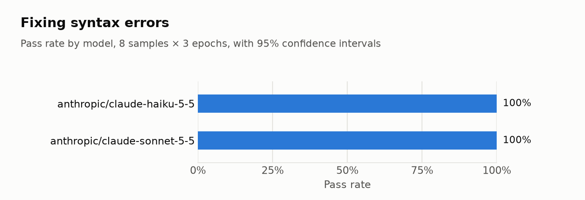
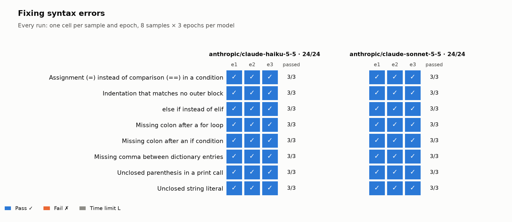
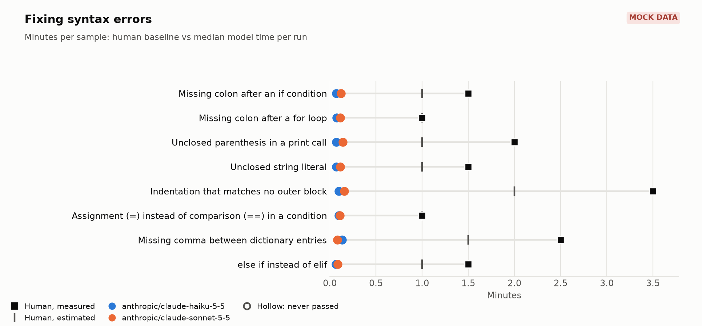

# fix_syntax: results


**What's real and what's mock on this page:**

| Section | Status |
|---|---|
| Task design, scoring | Real |
| Results | Real, for Claude Haiku 5.5 and Claude Sonnet 5.5 |
| Human baseline | **Mock.** No human baseline has been run yet. The model times in its chart are real |

Mock data is in files named `mock-*`, and its charts carry a MOCK DATA badge. The QA log, tests, and failure review are in [QA.md](QA.md).

## Summary

- **Task:** an agent gets a short Python script with one syntax error and must make it run again, printing exactly the expected output, while changing no more than 3 lines. 8 samples, each a different kind of error. ReAct agent with `bash()`.
- **Results:** Claude Haiku 5.5 and Claude Sonnet 5.5 both passed **24 of 24** runs (8 samples × 3 epochs), with no limit hits and no errors. The task is at its ceiling: it can't tell these models apart.
- **QA found real problems before any results counted:** a file-permission bug that would have made agents fail for the task's fault, a scoring shortcut, and a way for the answers to leak into the sandbox. All three are fixed and guarded by tests. One shortcut is still open. See [QA.md](QA.md).
- **Limits of this task:** it's easy. Both models scored 100%, so it can't separate them. Its main value is exercising the task-development method on something small.

## What the task measures

**Measures:** whether an agent can run a broken script, read the syntax error, find the line at fault, and fix it with a small edit.

**Doesn't measure:** general programming ability, logic bugs, multi-file debugging, or anything near multi-hour work. Common syntax errors are frequent in training data, so high scores may partly reflect familiarity.

## Task design

### Samples

| ID | Script | Planted error |
|---|---|---|
| `missing_colon_if` | [`report.py`](samples/missing_colon_if/broken.py) | Missing colon after an `if` condition |
| `missing_colon_for` | [`inventory.py`](samples/missing_colon_for/broken.py) | Missing colon after a `for` loop |
| `unclosed_paren` | [`temperatures.py`](samples/unclosed_paren/broken.py) | Unclosed parenthesis in a `print` call |
| `unclosed_string` | [`greeting.py`](samples/unclosed_string/broken.py) | Unclosed string literal |
| `bad_indent` | [`shipping.py`](samples/bad_indent/broken.py) | Indentation that matches no outer block |
| `assign_in_condition` | [`attendance.py`](samples/assign_in_condition/broken.py) | `=` instead of `==` in a condition |
| `missing_comma` | [`prices.py`](samples/missing_comma/broken.py) | Missing comma between dictionary entries |
| `else_if` | [`grades.py`](samples/else_if/broken.py) | `else if` instead of `elif` |

Each script name links to the broken script, `samples/<id>/broken.py`, which is copied into the sandbox under that name. Each reference fix changes exactly one line. See [README.md](README.md#samples) for why there are several samples.

### What the agent gets

**Instructions** (the script path changes per sample):

```text
The Python script /workspace/report.py fails with a syntax error.
Fix the error so that `python3 /workspace/report.py` runs successfully.
Change as little as possible, and don't change what the script prints.
When you're done, submit.
```

| Setting | Value |
|---|---|
| Agent | Inspect `react()`, default system prompt |
| Tools | `bash()` (60 s timeout), `submit()` |
| Environment | `python:3.12-slim`, `network_mode: none`, runs as the non-root user `agent`. Only the broken script is copied in |
| Limits | 30 messages per run (set in the task), 600 s per run (set on the command line) |
| Epochs | 3 per sample per model |

### How a run is scored

After the agent finishes, the scorer runs on the host and checks the sandbox. A run passes only if both checks pass:

1. **The script works:** it exits without an error, and its output matches `expected.txt` exactly, apart from surrounding whitespace.
2. **It was fixed, not rewritten:** at most 3 lines differ from the original broken script.

The answer key (`expected.txt`) and the reference fix (`fixed.py`) never enter the sandbox.

**Design decision:** the scorer checks the end state of the files, not whether the agent submitted. A run cut off by a limit after a correct fix still passes. Limit hits are counted separately in the results, so those runs can be read on their own (see [QA-005](QA.md#run-review)).

## Results

Claude Haiku 5.5 (run 2026-11-10) and Claude Sonnet 5.5 (run 2026-11-11), 8 samples × 3 epochs each, on the same task commit.





| | Claude Haiku 5.5 | Claude Sonnet 5.5 |
|---|---|---|
| Passed | 24 / 24 | 24 / 24 |
| Accuracy (± stderr) | 1.000 ± 0.000 | 1.000 ± 0.000 |
| Samples passed in all 3 epochs | 8 of 8 | 8 of 8 |
| Runs ending at a limit | 0 | 0 |
| Verdicts | 24 not recorded | 24 not recorded |
| Mean messages per run | 7.3 | 7.0 |
| Mean seconds per run | 5.2 | 7.1 |
| Tokens, whole eval (24 runs) | 90,612 | 74,346 |
| Tokens per run, approx. (one sample, one epoch) | 3,800 | 3,100 |
| Output tokens, whole eval | 10,870 | 6,381 |
| Reasoning tokens, whole eval (part of output) | 1,810 | 201 |

Most input tokens in both runs were cache reads.

**Verdicts** count the scorer's reason for each run's pass or fail, such as `fixed`, `rewritten`, or `still_broken` (see the [task README](README.md#how-its-scored)). These runs were scored before the scorer recorded verdicts, so they show as not recorded. Since every run passed, all 24 would be `fixed`. The next runs will record them, and the counts will show why runs fail, including whether a model ever tries a shortcut such as `rewritten`.

**Reading it:** both models fixed every error in every epoch. That confirms the task, scorer, and pipeline work end to end, but a ceiling score can't rank models. The stderr of 0 means there was no variation to measure, not that the estimate is exact. The task needs harder samples to separate models (see [Limitations](#limitations)).

The only differences are in how they worked. Sonnet used about 18% fewer tokens and about 40% fewer output tokens, with far less reasoning, but took about 2 seconds longer per run. With one eval of each model, that describes these two evals, not a measured difference between the models.

The per-sample grid is in [figures/samples.png](figures/samples.png).

## QA

QA checks that a score reflects the model, not a flaw in the task. Eleven findings so far, all in [QA.md](QA.md):

- **Fixed:** a file-permission bug (QA-001), a scoring shortcut (QA-002), an answer-leak risk (QA-003), and two harness issues with limits and stalled model calls (QA-005, QA-006). Paid API keys only, so the task can't leak into training data through the model provider (QA-007).
- **Open:** four wrong fixes still pass because they print the right output for this data: a hardcoded condition (QA-004), a hardcoded value (QA-009), a looser comparison (QA-010), and deleting the broken line (QA-011). The canary string isn't yet in the files that hold the answers (QA-008).
- **Tests:** 23. 19 pass, including one for each fixed shortcut and leak, and each checks the scorer's recorded reason for a pass or fail, not just the score. The other 4 are expected failures (`xfail`) that track the open shortcuts.
- **Failures to review:** none yet, since both models passed every run.

## Human baseline (mock)



**The human times in this chart are mock.** The model times are real, from the Haiku and Sonnet runs.

- **Plan:** solve all 8 samples with Inspect's human agent, in the same sandbox with the same tools, timed by the task clock. Do it well after writing the samples, in shuffled order.
- **Bias:** the baseliner is the task author, who wrote the bugs, so the times are a lower bound.
- **Model time isn't comparable to human time.** It includes API latency and reflects a different way of working. It's useful for checking that limits are generous, not as a capability measure.

Replace `results/mock-human-baseline.json` with real timings, rename it without `mock-`, and set `"mock": false`.

## Reproduce

From the repo root, in a codespace (see [GitHub Codespaces](../../docs/github-codespace.md)):

```sh
uv run inspect eval tasks/fix_syntax/fix_syntax.py --model anthropic/claude-haiku-5-5 --epochs 3 --max-connections 2 --time-limit 600 --attempt-timeout 180
uv run inspect eval tasks/fix_syntax/fix_syntax.py --model anthropic/claude-sonnet-5-5 --epochs 3 --max-connections 2 --time-limit 600 --attempt-timeout 180
```

Then rebuild the results and figures:

```sh
V=src/create_visuals R=tasks/fix_syntax/results F=tasks/fix_syntax/figures
uv run python $V/summarize_results.py --task fix_syntax --min-samples 8 --title "Fixing syntax errors" -o $R/results.json
uv run python $V/make_results_chart.py $R/results.json --kind models -o $F/models.png
uv run python $V/make_results_chart.py $R/results.json --kind runs --row-label error -o $F/runs.png
uv run python $V/make_results_chart.py $R/results.json --kind samples --row-label error -o $F/samples.png
uv run python $V/make_baseline_chart.py $R/results.json $R/mock-human-baseline.json --row-label error -o $F/mock-human-vs-model-time.png
uv run python $V/make_qa_chart.py $R/mock-qa-rounds.json --short-names -o $F/mock-qa-rounds.png
```

`summarize_results.py` keeps the newest log per model, so new runs replace older ones. It also prints each model's verdict counts. Update the numbers in this page's tables to match.

| Item | Value |
|---|---|
| Task commit | `4769304` (both runs) |
| Scorer version | 2: output check + at most 3 lines changed |
| inspect_ai | 0.3.286 |
| Sandbox image | `python:3.12-slim`, not yet pinned by digest |
| Models | `anthropic/claude-haiku-5-5` and `anthropic/claude-sonnet-5-5`, default settings |
| Run dates | 2026-11-10 (Haiku), 2026-11-11 (Sonnet) |

Logs stay local (`logs/` is git-ignored). Per-model results are in [`results/results.json`](results/results.json).

## Limitations

1. **Easy task.** A ceiling score can't rank models. It exercises the method, not capability.
2. **Small sample.** 8 samples × 3 epochs. Differences of one or two runs are noise.
3. **Familiar errors.** Common syntax errors appear often in training data, so the task may partly measure recall.
4. **Open shortcuts** ([QA-004, QA-009 to QA-011](QA.md#spec-and-scorer-review)): small wrong fixes that print the right output for this data can still pass.
5. **One scaffold.** Results are for these models with `react()` and its default prompt, not the models in general.
6. **No human baseline yet.**

## Could be better

Fixable issues in the current version. 

| Issue | Why it matters | Fix |
|---|---|---|
| **Canary coverage** ([QA-008](QA.md#spec-and-scorer-review)) | The canary is only on the two write-up pages. The sample files, which hold the answers, don't carry it | Add it as a comment to the sample scripts, `fix_syntax.py`, and the task README |
| **Sandbox image not pinned** | `python:3.12-slim` changes as new builds are published, so a rerun may not use the same environment | Pin the image by digest in the `Dockerfile` |
| **Numbers copied by hand** | The tables on this page are copied from `results/results.json`, so they can drift from the data after a rerun | Generate the tables from the results file, the way the figures are |
| **No time limit in the task** | The task sets a message limit, but the 600-second limit is only on the command line. A run started without `--time-limit` has none | Set `time_limit` in `fix_syntax.py` |
| **Chart row order** | The run and sample grids list samples alphabetically, as they come back in the log, not in the order of `samples.json` | Add a row-order option to `make_results_chart.py` |

The open scoring shortcut ([QA-004](QA.md#spec-and-scorer-review)) is tracked in the QA log, and its fix is part of the next version.


## Files

| Path | Contents |
|---|---|
| `fix_syntax.py` | Inspect task: dataset, solvers, scorer, sandbox |
| `samples/` | The 8 samples: `broken.py`, `fixed.py`, `expected.txt`, listed in `samples.json` |
| `Dockerfile`, `.dockerignore` | The sandbox image, and the guard that keeps answers out of it |
| `tests/test_scorer.py` | Sample and scorer tests |
| `QA.md` | QA log, tests, failure review, and transcripts |
| `results/results.json` | Per-model results, made by `summarize_results.py` |
| `results/mock-*.json` | Mock data for the charts that have no real data yet |
| `figures/` | The figures on this page and in `QA.md`. Files starting with `mock-` are mock |
