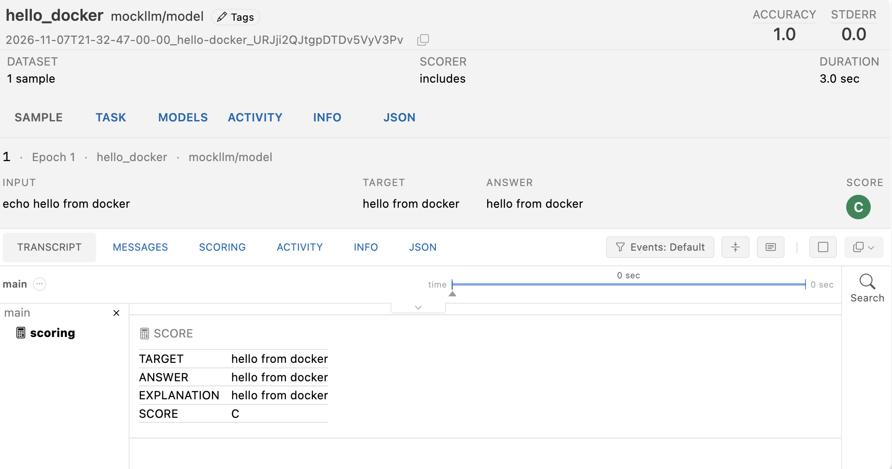
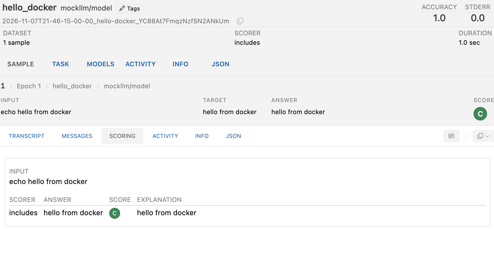

# hello_docker

A tiny task that checks Inspect and Docker work together. It runs one shell command, `echo hello from docker`, in a Docker sandbox and checks the output. It doesn't call a model, so it needs no API key and costs nothing.

## Run it

Docker Desktop must be running. From the repo root, run this as one line:

```sh
uv run inspect eval tasks/hello_docker/hello_docker.py --model mockllm/model
```

`--model` is required, but the mock model is never called. The run takes a few seconds and writes its log to `logs/`.

## What success looks like

The run finishes with an accuracy of 1. In the log viewer (`uv run inspect view --log-dir logs`), the sample looks like this:



- **Input:** the command that ran in the container, `echo hello from docker`.
- **Target:** the text the scorer looks for, `hello from docker`.
- **Answer:** what the container printed. It matches the target.
- **Score:** C, for correct. The `includes()` scorer checks that the answer contains the target.

## Scoring Explanation

The **Scoring** tab for the sample shows how the score was decided:



"C" means **correct**. It's Inspect's shorthand, not a letter grade. Inspect's scorers use four values:

| Value | Meaning | Counts toward accuracy as |
|---|---|---|
| `C` | Correct: the answer passed | 1 |
| `I` | Incorrect: the answer failed | 0 |
| `P` | Partial: partly right (only some scorers use it) | 0.5 |
| `N` | No answer to score | 0 |

How this sample got a C:

1. **Answer.** The solver ran `echo hello from docker` in the container and saved the output, `hello from docker`, as the answer.
2. **Scoring.** The `includes()` scorer checked whether the answer *contains* the target, `hello from docker`. It does, so it returned `C`. The **Explanation** column shows the text it compared.
3. **Accuracy.** The `accuracy` metric counts `C` as 1. With one sample, the task's accuracy is 1.0.

Two other details:

- **Stderr 0.0** is the standard error of the accuracy, a measure of how much it would vary across samples. With one sample there's nothing to vary, so it's 0. It only becomes meaningful with many samples.
- **The answer ends with a newline.** `echo` prints `hello from docker\n`. `includes()` checks for containment, not an exact match, so the newline doesn't matter. An exact-match scorer might be stricter, which is one reason to use `includes()` for command output.

## Running it several times

An **epoch** is one pass over the dataset. With 3 epochs, each sample runs 3 times, each time in a fresh container. Set it on the command line without changing the code:

```sh
uv run inspect eval tasks/hello_docker/hello_docker.py --model mockllm/model --epochs 3
```

Or add `epochs=3` to the `Task`. Inspect combines each sample's epochs into one score with a **reducer**. The default is `mean`, so 2 correct out of 3 counts as 0.67 for that sample.

**Extra epochs don't matter for this task.** Epochs measure how consistent a result is, which matters for models, because they can pass a task once and fail the next time. This task doesn't call a model, and `echo` prints the same thing every time. So 3 epochs give 3 identical `C`s, an accuracy of 1.0, and a stderr that's still 0. Epochs become useful for the ETL task, where the model's choices vary from run to run.

To check more here, add **samples** instead. Each sample tests something different:

```python
dataset=[
    Sample(input="echo hello from docker", target="hello from docker"),
    Sample(input="uname -s", target="Linux"),
    Sample(input="python3 --version", target="Python 3"),
],
```

## How it works

- `sandbox="docker"` tells Inspect to start a Docker container for the sample. This folder has no `Dockerfile` or `compose.yaml`, so Inspect uses its default image, `aisiuk/inspect-tool-support`. To use a different image, add a `Dockerfile` here. See [How Inspect picks the sandbox image](../../docs/eval-architecture.md#how-inspect-picks-the-sandbox-image).
- A small custom solver, `run_in_sandbox()`, runs the sample's input with `sandbox().exec()` and saves the output as the answer. It replaces the usual model call.
- After the sample is scored, Inspect removes the container.

## Troubleshooting (if failure)

- **"permission denied: tasks/hello_docker/hello_docker.py":** the command was split across two lines. Run it as one line.
- **"No model specified":** add `--model mockllm/model`.
- **Docker errors:** check that Docker Desktop is running with `docker run --rm hello-world`.
